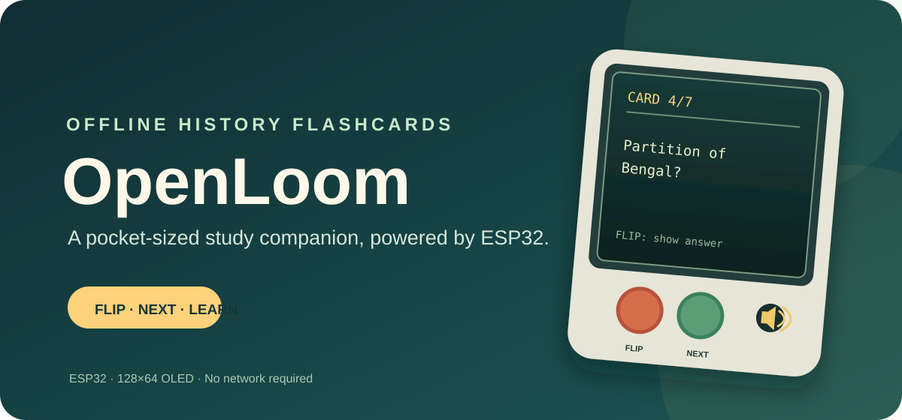
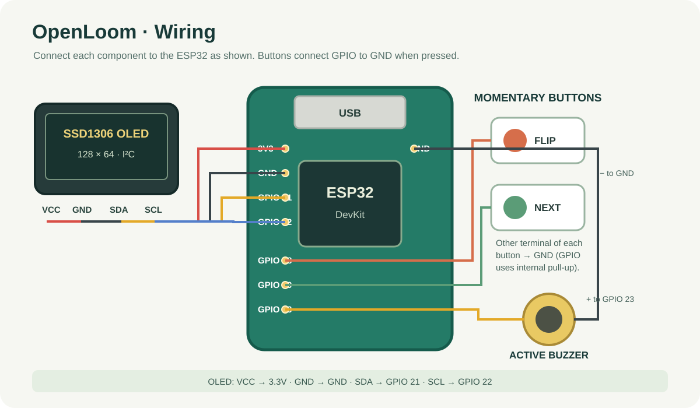

# OpenLoom

OpenLoom is a small, offline History flashcard device built around an ESP32 and a 128×64 I²C OLED. It displays one question at a time; press **FLIP** to reveal its answer, then **NEXT** to move to the next card.

## What it does

- Shows the current card number and a History question on the OLED.
- Toggles between the question and its answer with the FLIP button.
- Advances to the next card with NEXT, returning to the question side.
- Starts on a randomly selected card and then advances through the deck in order.
- Beeps on button presses. The example deck covers events in Indian history.

## Parts

| Part | Quantity | Notes |
|---|---:|---|
| ESP32 DevKit board | 1 | Select **ESP32 Dev Module** in Arduino IDE; match the USB cable to the board. |
| 0.96-inch I²C OLED display | 1 | SSD1306, 128×64, commonly at I²C address `0x3C`. |
| Tactile push buttons | 2 | FLIP and NEXT; each connects its GPIO pin to GND when pressed. |
| Active buzzer | 1 | Compatible with 3.3V GPIO drive; positive lead to GPIO 23. |
| Breadboard | 1 | For assembly without soldering. |
| Jumper wires | 15 | For power and signal connections. |
| USB cable | 1 | Micro-USB or USB-C to match your ESP32 board. |

See [`BOM.csv`](BOM.csv) for the parts list. Verify the buzzer's voltage and current requirements against your board; use a suitable transistor driver if the buzzer cannot be driven safely from a GPIO pin.

## Wiring

| Part connection | ESP32 connection |
|---|---|
| OLED SDA | GPIO 21 |
| OLED SCL | GPIO 22 |
| OLED VCC / GND | 3.3V / GND |
| FLIP button | GPIO 18 and GND |
| NEXT button | GPIO 19 and GND |
| Buzzer positive / negative | GPIO 23 / GND |

The buttons use the ESP32's internal pull-up resistors, so each button should connect the indicated GPIO to GND when pressed. Check your OLED pin labels before wiring; do not assume the order of its pins matches the diagram.

## Build and run

1. Install the Arduino IDE and install ESP32 board support using the Boards Manager.
2. Install **Adafruit GFX Library** and **Adafruit SSD1306** from the Arduino IDE Library Manager.
3. Open `openloom.ino` in Arduino IDE. If needed, put it in a folder named `openloom` first.
4. Connect the ESP32 by USB, select **ESP32 Dev Module** and the correct port, then upload.
5. Power the board. The first card appears on the OLED; use FLIP and NEXT to study.

The firmware uses the default SSD1306 I²C address `0x3C`. If your display uses another address, update `OLED_ADDR` in the sketch.

## Customize the cards

Edit the `cards[]` array near the top of `openloom.ino`. Add entries in the form `{"Question?", "Answer"}`. The firmware chooses a random starting card at boot and advances through the deck from there.

## CAD

Editable CAD (Onshape): https://cad.onshape.com/documents/YOUR-FULL-LINK

## Language composition

- Python: 60.1%
- C++: 39.9%

## License

MIT. See [`LICENSE`](LICENSE).
